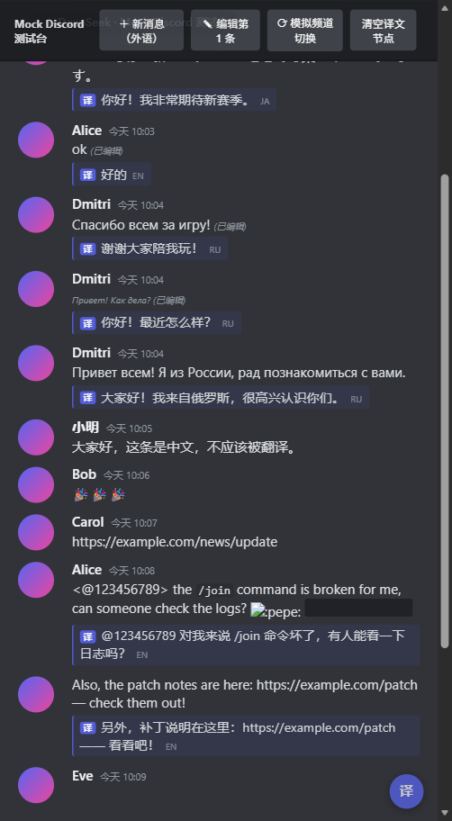
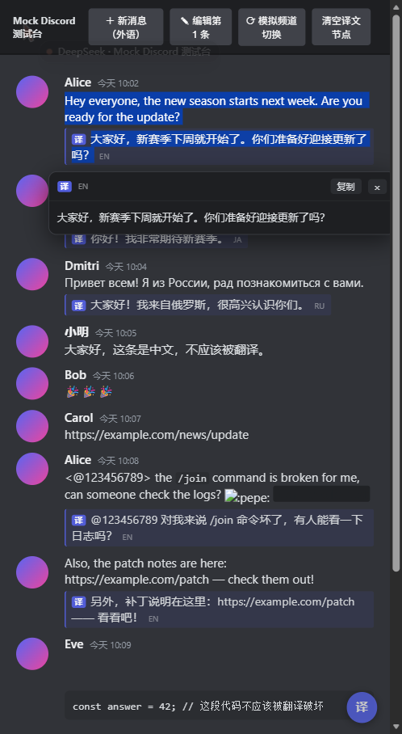
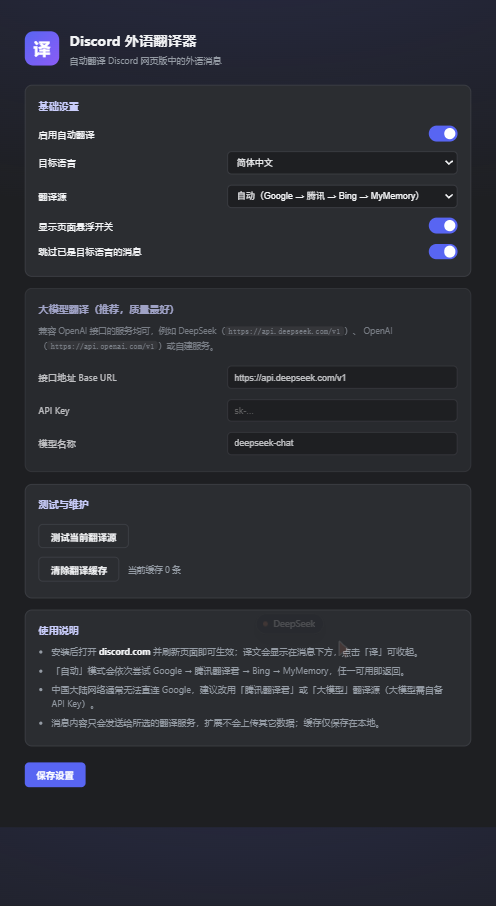
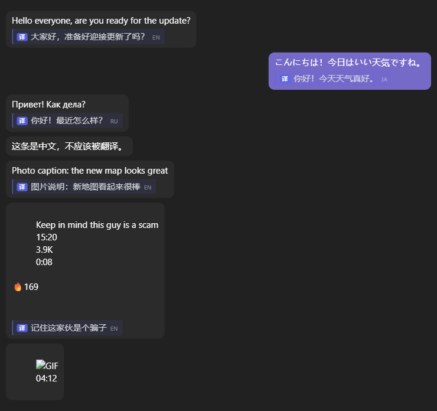
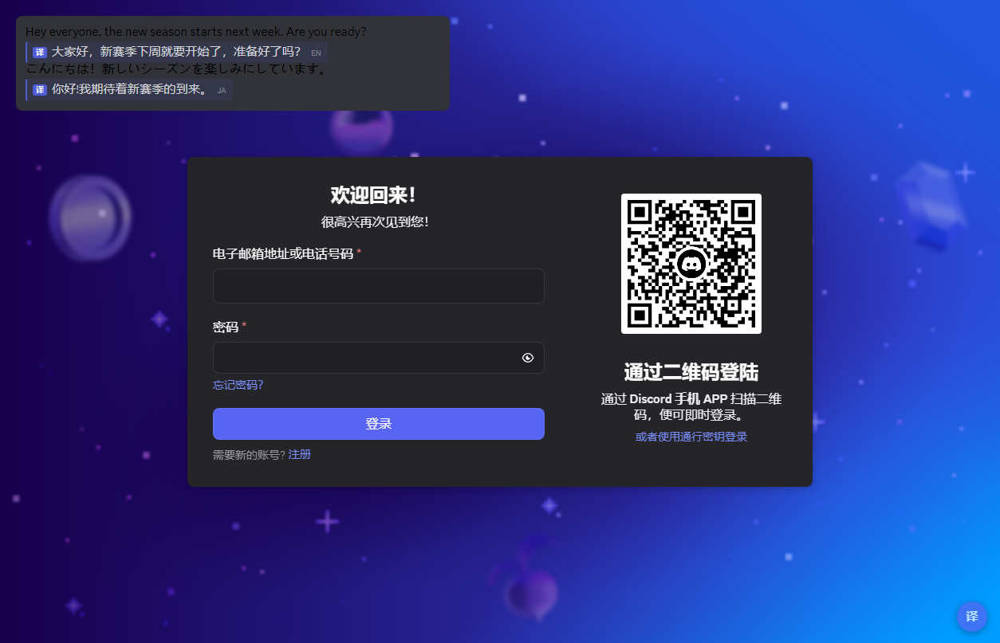

# Discord / Telegram Foreign Language Translator

[简体中文](README.md) | **English**

Automatically detects foreign-language messages in **Discord** and **Telegram Web** and appends a translation below each message. Designed for Chinese users — the default target language is Simplified Chinese, and you can switch it.

[](LICENSE)
[](CHANGELOG.md)
[](manifest.json)

> Works in Chromium-based browsers such as Chrome and Edge (Manifest V3). Supports Discord Web, Telegram Web K (`web.telegram.org/k`) and Web A (`web.telegram.org/a`). Desktop clients are not supported.



---

## Features

- **Two sites**: Discord Web + Telegram Web (both K and A interfaces)
- **Automatic translation**: new messages are translated as they arrive, with the translation shown below the original; Chinese text, pure emoji and bare links are skipped
- **Pre-send translation**: type in your own language, and the message is translated into your chosen language before it is sent; optionally keep the original below the translation; use an `en: 你好` prefix to override the target language for one message
- **Selection translation**: select any text in a message and click the “译” button next to the selection to translate it — the result can be copied; can also be set to translate on selection
- **Reply quote translation** (Discord): the quoted content of a reply is translated separately and shown under the quote
- **Edited messages** (Discord): messages marked as edited are translated normally, and the marker/timestamp never leaks into the translation
- **Link card translation** (Discord): titles and descriptions in link previews / bot embeds are translated and shown below the card
- **Many providers**: Google, Tencent Translator, Bing, MyMemory, DeepL, Youdao, LibreTranslate, LLMs, Tencent Hunyuan (`hunyuan-lite` is free), and **built-in on-device translation (offline, no key)**
- **Offline fallback**: when every network provider is down, click “Download built-in translation pack” once and the browser’s own translator works offline (Chrome/Edge 138+)
- **Automatic failover**: if a provider fails, gets rate-limited or does not support a language pair, the next one is tried automatically; configured DeepL / Youdao / LibreTranslate / LLM endpoints join the rotation automatically
- **Original preserved**: translations are appended in a “译” block; click it to collapse/expand
- **Floating toggle**: the “译” button in the bottom-right corner toggles automatic translation
- **Cache**: identical text is requested only once — scrolling, paging and channel switching cost nothing extra
- **Edit tracking**: edited messages are re-translated automatically
- **Diagnostics**: the popup can copy a diagnostic report to help debug messages that were not translated

### Screenshots

| Selection translation | Settings |
| --- | --- |
|  |  |





---

## Installation

### Option 1: Download a Release (recommended)

1. Download the latest `discord-translator-*.zip` from [Releases](../../releases) and unzip it
2. Open the browser’s extension page:
   - Chrome: `chrome://extensions`
   - Edge: `edge://extensions`
3. Enable “Developer mode” in the top-right corner
4. Click “Load unpacked” and select the unzipped **discord-translator** folder (the one containing `manifest.json`)
5. Open or refresh <https://discord.com> — a blue “译” button in the bottom-right corner means it is working

### Option 2: From source

```bash
git clone https://github.com/<your-name>/discord-web-translator.git
```

Then follow steps 2–5 above and load the `discord-web-translator` folder. There is no build step — the source is the product.

---

## Usage

- **Automatic mode**: just open Discord; foreign-language messages get translations automatically
- **Manual translation**: click the toolbar icon → “Translate messages on this page”
- **Selection translation**: select text in a message → click “译” → a translation card appears (copyable, Esc to close)
- **Temporarily disable**: click the “译” button in the bottom-right corner (grey means off)
- **Change settings**: toolbar icon → “More settings”, or “Extension options” on the extensions page

---

## Providers and network requirements

| Provider | Key required | Notes |
| --- | --- | --- |
| Google | No | Reliable quality, but **not directly reachable from mainland China**; a proxy is required. Rate-limited requests are skipped automatically |
| Tencent Translator | No | **Works from mainland China without a proxy**; supports Chinese/English/Japanese/Korean/French/German/Spanish and more. A few languages such as Russian are unsupported and fall back automatically |
| Bing | No | Uses Edge’s web translation endpoint; may break when Microsoft changes it |
| MyMemory | No | Free quota of about 5,000 characters/day; fine for occasional use |
| DeepL | Yes | Official API, high quality; the free key allows 500k characters/month (api-free.deepl.com) |
| Youdao | Yes | Official API, reachable from mainland China, small free quota; good for users without a proxy |
| LibreTranslate | Depends on instance | Self-hosted or private instance; URL is configurable |
| LLM | Yes | Any OpenAI-compatible endpoint; DeepSeek is recommended (`https://api.deepseek.com/v1` + `deepseek-chat`) for the best quality |

“Automatic” tries providers in this order: **Google → Tencent → Bing → MyMemory → (configured DeepL / Youdao / LibreTranslate / LLM)**. If a provider fails, does not support the language pair, or echoes the input unchanged, the next one is tried.

> For the best results, choose “LLM” in the settings and enter a DeepSeek or OpenAI API key.

---

## Performance design

- **Circuit breaker**: after 2 consecutive failures a provider cools down (3 minutes for normal errors, 30 seconds for rate limits) and “Automatic” mode skips it
- **Token-bucket rate limiting**: 2 burst requests and one token every 160 ms — concurrent but polite
- **Visible first**: messages on screen are translated first, so long channels do not waste quota on off-screen history
- **Backoff and retry**: failed messages retry with exponential backoff starting at 10 seconds; switching back to the tab, clicking “Translate messages on this page” or the “译” button resets the breakers and retries immediately
- **Echo fallback**: if a provider returns slang/abbreviations unchanged (e.g. `thank u`), the next provider is tried
- **Fast failure**: network-level errors (blocked/DNS) are attempted once; only 429/5xx responses are retried

---

## Privacy

- Message text is only sent to **the translation service you selected** (Google / Tencent / Bing / MyMemory / DeepL / Youdao / your own LibreTranslate or LLM endpoint)
- The extension collects and uploads nothing else; no analytics, no remote configuration
- The translation cache lives in `chrome.storage.local`, expires after 30 days and holds at most 1,200 entries
- See `host_permissions` in `manifest.json` for the domains that are accessed

---

## Known limitations

- **Code blocks**: a message is translated as a whole, including code; most providers preserve code, but comments may be translated
- **Spoilers**: spoiler text is never translated (to avoid leaking spoilers)
- **Image/attachment-only messages**: nothing to translate, so they are skipped
- **Translation identical to the original**: for typos (`goos`) or proper nouns the provider may echo the input, in which case no translation is shown
- **Discord redesigns**: selectors rely on stable `id` prefixes (`chat-messages-*`, `message-content-*`, `message-reply-context-*`). If Discord overhauls its DOM, the constants at the top of `content/content.js` may need updating
- **Virtualized lists**: messages scrolled out of view are recycled; translations are restored from the cache when they scroll back, essentially seamlessly
- **Web only**: Discord / Telegram desktop clients are not supported
- **Telegram quotes and cards**: only message bodies and media captions are translated; Discord-specific reply-quote and link-card translation is not yet available on Telegram
- **Telegram virtualized list**: recycled messages restore their translation from the cache when scrolled back
- **Built-in translation needs Chrome/Edge 138+**: the language pack is downloaded once via “Download built-in translation pack”, after which it works offline
- **Google needs a proxy or mirror**: some networks/exit IPs get redirected to Google’s CAPTCHA page; a “Google mirror URL” (e.g. a Cloudflare Worker reverse proxy) can be configured in the settings

---

## Development

There is no build step — load the source directly in the browser to debug.

```bash
# Static validation + unit tests (no network needed)
npm test

# Real-browser end-to-end tests (requires Edge installed)
npm run test:e2e
```

- `test/validate.cjs`: manifest, file references, script syntax, UTF-8 encoding, permission domains
- `test/background.test.cjs`: provider parsing, fallback, circuit breaking, caching, etc. (mocked fetch)
- `test/e2e-extension.mjs`: loads the extension in real Edge and verifies the service worker, options page, discord.com injection, replies/edited messages, selection translation and Telegram
- End-to-end runs headless by default; use `set E2E_HEADFUL=1` to verify real providers (headless browsers are blocked by Bing and others with HTTP 401)
- `test/mock-discord.html`: interactive Discord-DOM mock (ships a chrome API shim; open it directly in a browser)
- `test/mock-telegram-k.html` / `test/mock-telegram-a.html`: Telegram Web K / A message-structure mocks

> `e2e-extension.mjs` may not be able to launch Chromium in restricted containers/sandboxes; run it on a normal desktop.

### Directory layout

```
discord-translator/
├── manifest.json               # MV3 manifest
├── background/
│   └── service-worker.js       # Translation orchestration: failover, breakers, rate limiting, cache
├── content/
│   ├── content.js              # Message discovery, language detection, rendering, selection translation
│   └── content.css             # Translation block / selection card styles
├── popup/                      # Toolbar popup
├── options/                    # Options page
├── shared/langs.js             # Shared language and provider lists
├── icons/                      # Icons (generated by tools/make-icons.py)
├── test/                       # Unit tests, static validation, E2E, mock pages
├── tools/                      # Icon and preview generation scripts
├── docs/                       # README screenshots
├── .github/workflows/ci.yml    # GitHub Actions: npm test
├── package.json
├── CHANGELOG.md
├── CONTRIBUTING.md
└── LICENSE
```

### Notes on adapting to Discord

Discord’s `className` values are build hashes (e.g. `messageContent_2i8Bfm`) and must not be used as selectors. The extension relies only on stable `id` prefixes:

- Message rows: `li[id^="chat-messages-"]`
- Message body: `[id^="message-content-"]` (a reply may contain two: the quoted body and the reply body)
- Reply context: `[id^="message-reply-context-"]`

A `MutationObserver` watches for new and edited messages, with a fallback scan every 3 seconds to catch virtualized-list recycling and SPA route changes.

---

## Publishing to GitHub

```bash
git init
git add .
git commit -m "feat: Discord translator v1.5.0"
git branch -M main
git remote add origin https://github.com/<your-name>/discord-web-translator.git
git push -u origin main
```

For a release, zip the repository root as `discord-translator-1.5.0.zip` (it only needs `manifest.json` and the files it references) and upload it to Releases. CI runs `npm test` on every push/PR.

---

## Contributing

Issues and pull requests are welcome — see [CONTRIBUTING.md](CONTRIBUTING.md).

## License

[MIT](LICENSE)

## Disclaimer

This is a personal learning/hobby project and is not affiliated with Discord, Rockstar/Take-Two, Google, Tencent, Microsoft, DeepL or Youdao. The free translation endpoints are internal web APIs of those sites and may change or be rate-limited at any time. Please respect the respective terms of service and do not use it commercially.
