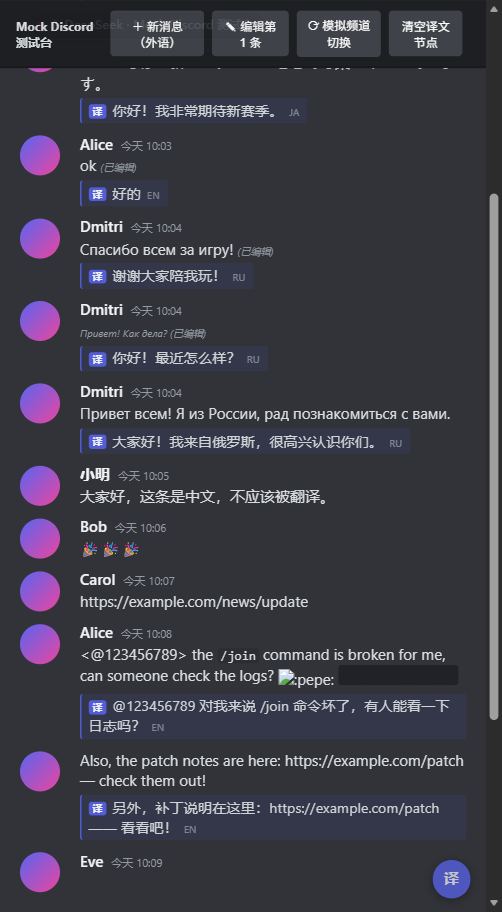
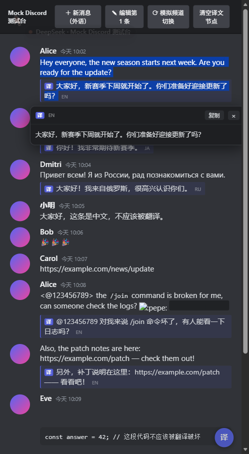
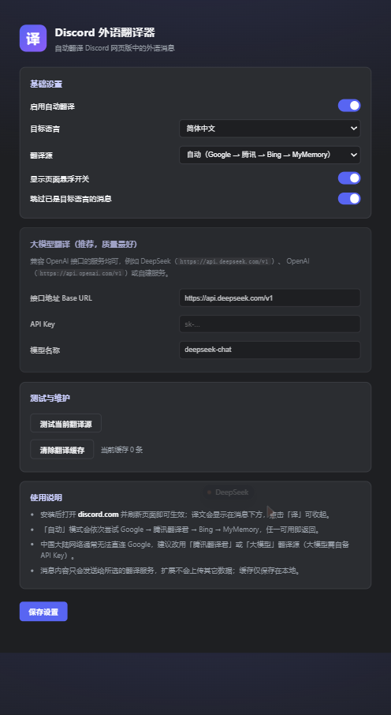
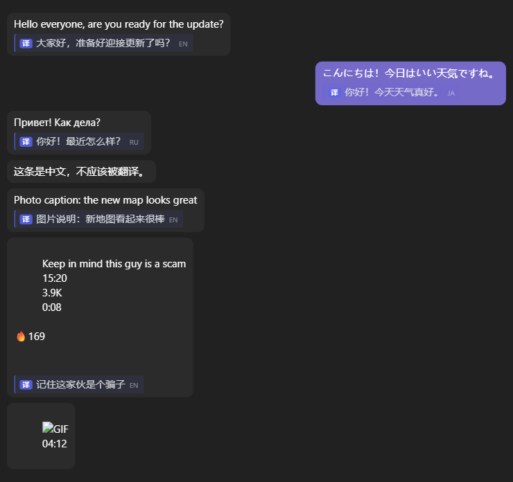
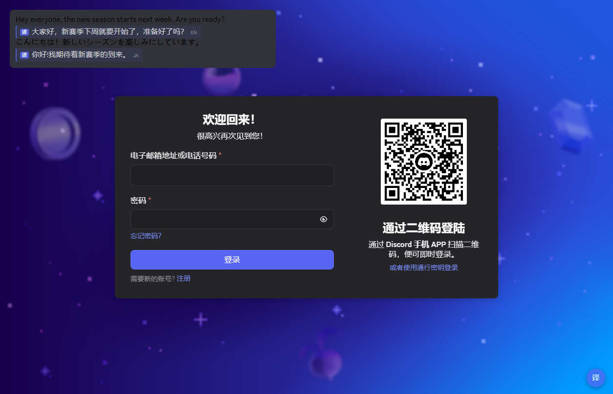

# Discord / Telegram 外语翻译器

自动识别 **Discord** 与 **Telegram 网页版**里的外语消息，并在消息下方追加译文。面向中文用户设计，默认翻译成简体中文，也可切换目标语言。

[](LICENSE)
[](CHANGELOG.md)
[](manifest.json)

> 支持 Chrome / Edge 等 Chromium 内核浏览器（Manifest V3）。支持 Discord 网页版、Telegram Web K（`web.telegram.org/k`）与 Web A（`web.telegram.org/a`），不适用于桌面客户端。



---

## 功能

- **双站点支持**：Discord 网页版 + Telegram Web（K / A 两套界面）
- **自动翻译**：新消息出现即翻译，译文显示在原文下方；中文、纯 emoji、纯链接会自动跳过
- **划词翻译**：用鼠标选中消息里的任意文字，点选区旁的「译」按钮即可翻译，支持复制；也可设为「选中即翻译」
- **引用消息翻译**（Discord）：回复消息里被引用的内容会单独翻译，显示在引用行下方
- **已编辑消息**（Discord）：带「(已编辑)」标记的消息照常翻译，标记和时间戳不会混进译文
- **链接卡片翻译**（Discord）：链接预览 / 机器人卡片里的标题与描述会翻译，显示在卡片下方
- **多种翻译源**：Google、腾讯翻译君、Bing、MyMemory、DeepL、有道智云、LibreTranslate、大模型，以及**浏览器内置端侧翻译（离线、免 Key）**
- **离线兜底**：所有网络翻译源都不可用时，点一次「下载内置翻译包」即可用浏览器自带翻译离线工作（Chrome/Edge 138+）
- **自动切换**：某个源失败、限流或语种不支持时自动换下一个；已配置的 DeepL / 有道 / LibreTranslate / 大模型会自动加入切换队列
- **原文保留**：译文以「译」块追加，不覆盖原文；点击「译」可收起/展开
- **悬浮开关**：页面右下角「译」按钮一键开关自动翻译
- **缓存**：相同文本只请求一次，翻页/滚动/切换频道不重复消耗额度
- **编辑跟随**：消息被编辑后自动重新翻译
- **诊断工具**：弹窗内置「复制诊断信息」，方便排查个别消息不翻译的问题

### 截图

| 划词翻译 | 设置页 |
| --- | --- |
|  |  |





---

## 安装

### 方式一：下载 Release（推荐给普通用户）

1. 到 [Releases](../../releases) 下载最新的 `discord-translator-*.zip` 并解压
2. 打开浏览器扩展管理页：
   - Chrome：`chrome://extensions`
   - Edge：`edge://extensions`
3. 打开右上角「开发者模式」
4. 点击「加载已解压的扩展程序」，选择解压后的 **discord-translator** 文件夹（含 `manifest.json` 的那一层）
5. 打开或刷新 <https://discord.com>，右下角出现蓝色「译」按钮即安装成功

### 方式二：从源码安装

```bash
git clone https://github.com/<your-name>/discord-web-translator.git
```

然后按上面第 2–5 步加载 `discord-web-translator` 文件夹即可。本扩展没有构建步骤，源码就是产物。

---

## 使用

- **自动模式**：打开 Discord 即可，外语消息会自动出现译文
- **手动翻译**：点击工具栏扩展图标 → 「翻译当前页消息」
- **划词翻译**：选中消息里的文字 → 点「译」→ 弹出译文卡片（可复制、Esc 关闭）
- **临时关闭**：点击页面右下角的「译」按钮（灰色表示已关闭）
- **修改设置**：点扩展图标 → 「更多设置」，或 `chrome://extensions` 里点「扩展程序选项」

---

## 翻译源与网络要求

| 翻译源 | 是否需要 Key | 说明 |
| --- | --- | --- |
| Google | 否 | 质量稳定，但**中国大陆网络无法直连**，需代理；接口被限流时会自动跳过 |
| 腾讯翻译君 | 否 | **国内可直连**，支持中/英/日/韩/法/德/西等常用语种；俄语等少数语种不支持，会自动回退 |
| Bing | 否 | 使用 Edge 网页翻译的免费接口，接口可能随微软调整而失效 |
| MyMemory | 否 | 免费额度约 5000 字符/天，适合偶尔使用 |
| DeepL | 是 | 官方 API，质量高，免费 Key 每月 50 万字符（api-free.deepl.com） |
| 有道智云 | 是 | 官方 API，国内可直连，免费额度较小；适合无代理用户 |
| LibreTranslate | 视实例 | 自建或私有实例，地址可配置 |
| 大模型 | 是 | 兼容 OpenAI 接口，推荐 DeepSeek（`https://api.deepseek.com/v1` + `deepseek-chat`），质量最好 |

「自动」模式会按 **Google → 腾讯翻译君 → Bing → MyMemory →（已配置的 DeepL / 有道 / LibreTranslate / 大模型）** 依次尝试；某个源失败、语种不支持或原样返回时自动换下一个。

> 想获得最佳效果：在设置里选择「大模型」，填入 DeepSeek 或 OpenAI 的 API Key。

---

## 性能设计

- **翻译源熔断**：某个源连续失败 2 次后进入冷却（普通错误 3 分钟、限流 30 秒），「自动」模式会跳过它
- **令牌桶限速**：允许 2 个突发请求、每 160ms 补充令牌，兼顾并发与礼貌
- **可见优先**：屏幕内的消息优先翻译，长频道不会先翻屏幕外的历史消息
- **失败退避重试**：失败消息 10 秒起按 2 倍退避重试；切回标签页、点「翻译当前页消息」或点「译」按钮都会立即解除熔断并重试
- **原样返回兜底**：某个源对俚语/缩写原样返回（如 `thank u`）时，自动换下一个源
- **快速失败**：网络级错误（被墙/DNS）只尝试一次，429/5xx 才重试

---

## 隐私

- 消息文本只会发送给**你选择的翻译服务**（Google / 腾讯 / Bing / MyMemory / DeepL / 有道 / 你自建的 LibreTranslate 或大模型接口）
- 扩展不收集、不上传任何其它数据；没有统计、没有远程配置
- 翻译缓存保存在浏览器本地（`chrome.storage.local`），30 天过期，最多 1200 条
- 需要访问的域名见 `manifest.json` 的 `host_permissions`

---

## 已知限制

- **代码块**：整条消息会连代码一起送翻译，模型/接口通常会保留代码，但注释可能被翻译
- **剧透**：带 spoiler 的文本不会被翻译（避免剧透外泄）
- **纯图片/附件消息**：没有文字可翻，会跳过
- **翻译结果与原文相同**：如拼写错误（`goos`）或专有名词，接口原样返回时不会显示译文
- **Discord 改版**：选择器基于稳定的 `id` 前缀（`chat-messages-*`、`message-content-*`、`message-reply-context-*`），若官方大改 DOM，可能需要更新 `content/content.js` 顶部常量
- **虚拟列表**：消息滚出屏幕会被回收，重新滚回时从缓存恢复译文，几乎无感
- **仅网页版**：不适用于 Discord / Telegram 桌面客户端
- **Telegram 暂不支持引用与卡片**：目前只翻译消息正文和媒体说明文字；Discord 专属的引用正文、链接卡片翻译尚未适配 Telegram
- **Telegram 虚拟列表**：消息滚出屏幕会被回收，重新滚回时从缓存恢复译文
- **内置翻译需 Chrome/Edge 138+**：语言包首次需要点一次「下载内置翻译包」，之后离线可用
- **Google 需代理或镜像**：部分网络/出口 IP 会被 Google 跳验证码页，可在设置里填「Google 镜像地址」（Cloudflare Worker 等反向代理）

---

## 开发

本扩展没有构建步骤，浏览器直接加载源码即可调试。

```bash
# 静态校验 + 单元测试（无需网络）
npm test

# 真实浏览器端到端测试（需要本机安装 Edge）
npm run test:e2e
```

- `test/validate.cjs`：manifest、文件引用、脚本语法、UTF-8 编码、权限域名
- `test/background.test.cjs`：翻译源解析、回退、熔断、缓存等（mock fetch）
- `test/e2e-extension.mjs`：真实 Edge 加载扩展，验证 Service Worker、设置页、discord.com 注入、引用/已编辑消息、划词翻译与 Telegram
- 端到端默认无头运行；需要验证真实翻译源时用 `set E2E_HEADFUL=1`（无头浏览器会被 Bing 等站点风控返回 401）
- `test/mock-discord.html`：模拟 Discord DOM 的交互测试页（自带 chrome API 桩，直接用浏览器打开）
- `test/mock-telegram-k.html` / `test/mock-telegram-a.html`：模拟 Telegram Web K / A 的消息结构

> `e2e-extension.mjs` 在受限容器/沙箱中可能无法启动 Chromium，需要在普通桌面环境运行。

### 目录结构

```
discord-translator/
├── manifest.json               # MV3 清单
├── background/
│   └── service-worker.js       # 翻译调度：多源回退、熔断、限速、缓存
├── content/
│   ├── content.js              # 消息发现、语言判断、译文渲染、划词翻译
│   └── content.css             # 译文块 / 划词卡片样式
├── popup/                      # 工具栏弹窗
├── options/                    # 设置页
├── shared/langs.js             # 公用语言与翻译源列表
├── icons/                      # 图标（tools/make-icons.py 生成）
├── test/                       # 单元测试、静态校验、E2E、模拟页面
├── tools/                      # 图标与预览生成脚本
├── docs/                       # README 截图
├── .github/workflows/ci.yml    # GitHub Actions：npm test
├── package.json
├── CHANGELOG.md
├── CONTRIBUTING.md
└── LICENSE
```

### 适配 Discord 的要点

Discord 的 `className` 是构建哈希（如 `messageContent_2i8Bfm`），不能作为选择器。扩展只用稳定的 `id` 前缀：

- 消息行：`li[id^="chat-messages-"]`
- 消息正文：`[id^="message-content-"]`（回复里可能有两个：引用正文 + 回复正文）
- 引用区：`[id^="message-reply-context-"]`

同时用 `MutationObserver` 监听新消息与编辑，并每 3 秒做一次兜底扫描，兜住虚拟列表回收和 SPA 路由切换。

---

## 发布到 GitHub

```bash
git init
git add .
git commit -m "feat: Discord 外语翻译器 v1.4.5"
git branch -M main
git remote add origin https://github.com/<your-name>/discord-web-translator.git
git push -u origin main
```

打 Release 时，把仓库根目录打包为 `discord-translator-1.4.11.zip`（包含 `manifest.json` 及其引用文件即可）上传到 Releases。CI 会在 push/PR 时自动运行 `npm test`。

---

## 贡献

欢迎提交 Issue 与 PR，详见 [CONTRIBUTING.md](CONTRIBUTING.md)。

## 许可证

[MIT](LICENSE)

## 免责声明

本项目为个人学习/自用工具，与 Discord、Rockstar/Take-Two、Google、腾讯、微软、DeepL、有道均无关联。使用的免费翻译接口均为各站点网页版内部接口，可能随时变更或限流；请遵守对应服务条款，勿用于商业用途。
